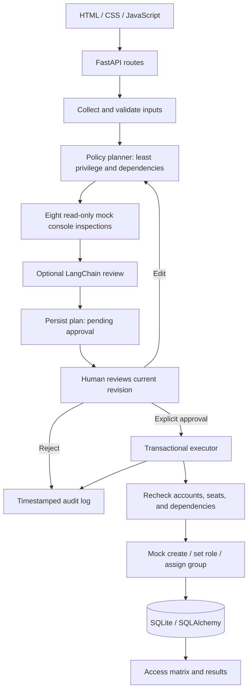

# New Hire Account Provisioner

A runnable FastAPI + SQLite onboarding sandbox with a plain HTML/CSS/JavaScript interface. Submit a fictional new hire, inspect a least-privilege access plan, explicitly approve it, and see the resulting account matrix and timestamped audit trail.

Eight persistent mock providers: **Slack, Google Workspace, GitHub, Jira, Confluence, Zoom, Salesforce, and AWS IAM**. These simulate SaaS behavior; their role names and department groups are simplified demo abstractions, not production vendor permission schemas.

## Run locally

For Cloudflare Workers, use the separate [Cloudflare deployment guide](docs/CLOUDFLARE.md).
The Worker uses D1-backed demo state; the local server below uses SQLAlchemy/SQLite.

Requires Python 3.10+ (verified with Python 3.12). From this project directory:

```powershell
python -m venv .venv
.\.venv\Scripts\Activate.ps1
pip install -r requirements-local.txt
Copy-Item .env.example .env
uvicorn app.main:app --reload
```

If PowerShell blocks activation, use `.\.venv\Scripts\python.exe -m pip install -r requirements-local.txt` and `.\.venv\Scripts\python.exe -m uvicorn app.main:app --reload` instead. On macOS/Linux, activate with `source .venv/bin/activate` and copy with `cp .env.example .env`.

Open **http://127.0.0.1:8000**. Interactive API documentation is at **http://127.0.0.1:8000/docs**. The database and synthetic seed data are created on startup. No Node build, SaaS credentials, or AI key is needed for the default demo.

## Configuration and AI behavior

**Acceptance audit:** see [requirement mapping and test evidence](docs/ACCEPTANCE.md). The expanded suite covers all eight providers and the four official scenarios.

**Policy modes:** `ACCESS_POLICY_MODE=approval` is the default and matches the original brief: any supported higher role can be explicitly approved by a human. Use `ACCESS_POLICY_MODE=strict` for the optional department restrictions described below. Admin access is blocked only in strict mode. Restart the server after changing this setting.

### Job-based recommendations and company policy

Enter the employee details and describe their responsibilities in **Let the agent suggest access**, then choose **Suggest apps & access**. With a configured Groq/OpenAI key, the model proposes a structured list of apps, minimum sufficient roles, and an explanation for each. The implementation uses LangChain's [structured function-calling output](https://reference.langchain.com/python/langchain-openai/chat_models/base/ChatOpenAI/with_structured_output). The server validates the result and saves a pending plan; it does not create accounts. The approval screen shows **Why this access?** for every app.

Without a key, or if the model returns invalid output or fails, the app explicitly labels department-based starter suggestions as automatic checks. These fallback suggestions use department templates, not AI interpretation of the job description.

Sample company policy is defined in `app/agent/policy.py`. Minimum roles are allowed across all apps. Common collaboration tools allow everyday access; Engineering allows GitHub/Jira editing and AWS developer access; Sales/Marketing allow Salesforce standard access; other departments have narrower permissions. Admin access requires a separate IT process and is blocked in this application. These are editable demo policies, not claims about a real company's rules.

Policy is enforced during manual plan creation, recommendation validation, edits, and approval. Disallowed AI roles are reduced to the tool's minimum role with a visible explanation; disallowed manual requests are rejected with an actionable error. Responsibilities, explanations, and policy versions are retained in the audit record. No schema migration is needed for existing databases.

New endpoints: `POST /api/hires/recommend` (employee details plus `responsibilities`) and `GET /api/hires/policy?department=Sales`. The new request body excludes `assignments` because the agent proposes them. Conversational editing, authenticated reviewers, and targeted retry workflows are not part of this first three-priority update.

| Variable | Default | Purpose |
| --- | --- | --- |
| `DATABASE_URL` | `sqlite:///./provisioner.db` | Local SQLite storage; SQLite is the supported database. |
| `GROQ_API_KEY` | empty | Optional Groq key for LangChain AI review; preferred when both provider keys are set. |
| `GROQ_MODEL` | `llama-3.3-70b-versatile` | Tool-capable Groq model for plan review. |
| `OPENAI_API_KEY` | empty | Optional key for LangChain AI review. Keep it in the ignored `.env` file. |
| `OPENAI_MODEL` | `gpt-4.1-mini` | Tool-capable model to use for optional review. |

**Rules-based mode** is fully functional offline and is labeled in the UI. It does not claim to run an LLM. With a configured API key, the LangChain model can call the read-only `inspect_tool` tool to inspect selected mock consoles and summarize plan risks. This follows LangChain's [tool binding pattern](https://www.langchain.com/blog/tool-calling-with-langchain). AI review is bounded to three rounds, with request timeouts and a rules-based fallback on failure. The model cannot approve, mutate accounts, change policy, or select roles outside the validated plan. The deterministic planner remains authoritative in both modes.

Only synthetic plan information is sent for optional AI review. Use fictional names and reserved `example.com`, `example.org`, or `example.net` emails; other email domains are rejected. Names cannot be automatically proven fictional, so use the demo helper or invented names.

This is a **single-operator local demo**, without login or reviewer identity verification. The API requires an explicit approval decision and confirmation, but does not authenticate a human reviewer. Do not expose it as a production provisioning service. No real SaaS APIs are called.

## Walkthrough and UI description

To use Groq, set `GROQ_API_KEY` and optionally `GROQ_MODEL` in `.env`, then restart the server. No additional dependencies are needed: the existing LangChain client uses Groq's [OpenAI-compatible endpoint](https://console.groq.com/docs/overview) for chat completions and read-only tool calls. If both keys are present, Groq takes priority. Authentication or provider errors fall back to the labeled rules-based review.

### Updated interface

Readability update: primary labels and controls use 14–15px text. Manual app selection and recommendations are separate keyboard-accessible tabs that preserve input. Desktop app selection uses two columns; mobile shows permission selectors only for selected apps, with an accessible submit area near the bottom of the viewport.

The latest visual revision uses compact application rows, neutral surfaces, smaller headings, and a focused action sidebar. Promotional slogans, placeholder company/profile blocks, repeated reassurance panels, and decorative footer copy were removed. Help remains available on demand; recommendation explanations and approval warnings remain visible where relevant. The screenshots below show the current revision.

The refreshed interface includes a guided introduction, plain-language access descriptions, a sample employee button, mobile navigation, and an in-app **How it works** guide. Apps start unselected; the sample fills four starter apps. Review changes can be undone or discarded, unsaved changes block approval, and rejection asks for confirmation. The request list supports searching by name/email/department and filtering by status, including rejected requests. Results explain the next step and keep the detailed activity history collapsed until needed.

Browser-verified screenshots:

- [New employee — desktop](docs/screenshots/new-employee-desktop.png)
- [New employee — mobile](docs/screenshots/new-employee-mobile.png)
- [Review access](docs/screenshots/review-desktop.png)
- [Requests and results](docs/screenshots/requests-desktop.png)
- [Completed request](docs/screenshots/results-desktop.png)

For UI regression checks, run `python scripts/preview-server.py` in one terminal. This creates a temporary database, disables AI keys for the test process, and serves port 8015 without touching the main database. In another terminal run `node scripts/check-ui.cjs <path-to-playwright-or-playwright-core>`. A local Playwright installation and its Chromium browser are needed for this optional check; normal app usage needs neither. The check covers the guide, sample form, undo, editing, approval, rejection, search, filters, and mobile navigation. Screenshots are written to `docs/screenshots/`.

The interface uses a quiet green-and-white operations dashboard with a sidebar, a three-step progress indicator, responsive cards, and keyboard-accessible native form controls.

1. **Hire details (`/`)** — enter name, synthetic work email, department, title, manager, and start date. “Fill demo hire” creates fictional details with a fresh email. Select any of eight application cards and choose roles. The lowest role is selected by default. A live summary shows the employee and selected apps.
2. **Review and approve (`/approval?id=…`)** — see capacity, existing account detection, provider default overrides, dependency order, department groups, and elevated-role warnings. Change roles or remove individual assignments, then save to generate a fresh revision. Edits disable approval until saved. Explicitly check the confirmation box and click **Approve & provision** to execute, or reject the request without account changes.
3. **Access dashboard (`/dashboard`)** — browse saved requests. Each completed request shows created, reused, partial, and failed counts; a tool/requested-role/actual-role/status matrix; clear failure explanations; and timestamped logs. Export the full request and audit log as JSON.
4. **Mock SaaS console** — use the sidebar to change capacity, provider default roles, and create/group failure simulations. “Fill seats (TC.4)” fills the capacity input to current usage; **Save mock settings** applies it. These controls are for synthetic test conditions only. Restore capacity to 100 and failure simulation to None after testing.

## Four official scenarios

All scenarios have automated tests. They use independent temporary SQLite databases and never require API credentials.

```powershell
python -m pytest -q
```

Run just the official scenario files:

```powershell
python -m pytest -q tests/test_tc1_approved_tools.py tests/test_tc2_user_exists.py tests/test_tc3_default_role.py tests/test_tc4_seat_limit.py
```

| Case | Manual setup | Expected result |
| --- | --- | --- |
| TC.1 Approved tools | Fill a fresh demo hire, select all eight tools, keep minimum roles, generate and approve. | Eight accounts created with the exact approved minimum roles and department groups. |
| TC.2 User already exists | Use `existing@example.com`, select all tools, approve. | Seeded Google Workspace, Slack, and GitHub accounts are reused; no duplicates or extra seats. Other accounts are created on the first run. |
| TC.3 Default role override | GitHub is seeded with an `admin` default. Request a fresh email with GitHub `viewer`, approve. | Actual role is `viewer`; the provider's admin default is explicitly overridden. |
| TC.4 Seat limit reached | In the mock console choose Salesforce, click Fill seats, then Save. Submit a fresh hire for all tools and approve. | Salesforce reports Partial Access with a capacity explanation; other tools proceed. |

Seed data uses 12 reserved seats per tool to represent unrelated synthetic accounts; Google Workspace, Slack, and GitHub additionally contain Morgan Example (`existing@example.com`). Default capacity is 100, so TC.1 works immediately. TC.4 deliberately changes one tool's capacity instead of making the default seed fail TC.1. Seed initialization is idempotent and preserves prior demo settings and accounts.

Extra tests cover missing approval, stale revisions, rejection, elevated permissions, invalid roles, duplicate selections, unsupported email domains, repeated approval, changing capacity, dependency failures, group failures, and route availability.

## Architecture



The agent follows **collect → plan → find information → act with approval**. Google Workspace precedes Slack when both are selected. A failed Google Workspace account creation blocks a new Slack account, while unrelated providers continue. If only Slack is selected, it assumes the supplied synthetic email is already available outside the selected plan.

`BEGIN IMMEDIATE` serializes approval and mock-settings writes in SQLite, so concurrent approvals cannot consume the same final seat or duplicate an account. A database uniqueness constraint also enforces one account per tool and normalized email. Repeated approvals return the saved result without replaying actions. Revision checks prevent stale approval after edits. Accounts, final results, and audit records are committed together; individual provider savepoints isolate unexpected provider failures. These transaction guarantees apply to the local mock database, not external APIs.

Existing accounts are reconciled to the exact approved role, including downgrades. Existing groups are preserved and the approved department group is added. A seat shortage produces `partial` without an account; a group failure produces `partial` with an account and actual role; a create failure produces `failed`. Availability is rechecked at execution, so preview warnings may change by approval time. For failed/partial requests, resolve the mock condition and create a new request; previously created accounts will be reused.

## Source layout

```text
app/
  main.py                       FastAPI lifespan, static pages, API registration
  database.py                   SQLAlchemy engine and sessions
  agent/
    validator.py                Strict input and role validation
    planner.py                  Ordered policy plan and provider inspections
    provisioner.py              Optional LangChain read-only review
  models/
    employee.py                 Hire request, plan, revision, results
    tool_account.py             Mock accounts and provider configuration
    provisioning_log.py         Timestamped audit events
  services/
    mock_saas/                  Shared simulator and eight provider classes
    provisioning_service.py     Approval checks, transactional execution
    seed.py                     Idempotent synthetic seed data
  routes/
    hire.py                     Create/read requests and edit pending plans
    provision.py                Explicit approval/rejection endpoint
    dashboard.py                Catalog, request list, mock inspection/settings
frontend/                       Three HTML entry points, shared CSS and JS
tests/                          Official scenarios and regression tests
```

## API overview

| Method and route | Behavior |
| --- | --- |
| `POST /api/hires` | Validate details and persist a pending plan; never creates SaaS accounts. |
| `GET /api/hires/{id}` | Plan, revision, result, and audit log. |
| `PUT /api/hires/{id}/plan` | Replace pending assignments; increments revision. |
| `POST /api/hires/{id}/decision` | Requires `revision`, `decision: approve/reject`, and `confirmed: true`. |
| `GET /api/catalog` | Tools, allowed roles, current seats, and defaults. |
| `GET /api/dashboard` | Most recent 100 requests. |
| `GET /api/mock/{tool}/inspect?email=…` | Simulated account, seats, and default role lookup. |
| `PUT /api/mock/{tool}/settings` | Configure synthetic capacity, defaults, or failure scenarios. |
| `GET /api/health` | Server readiness response. |

Account creation and group assignment are intentionally available only through the approved executor; there is no unauthenticated mock-create route that bypasses approval. Every provider class supports `check_user_exists`, `get_seat_count`, `get_default_role`, `create_account`, and `assign_group`, plus explicit role reconciliation.
